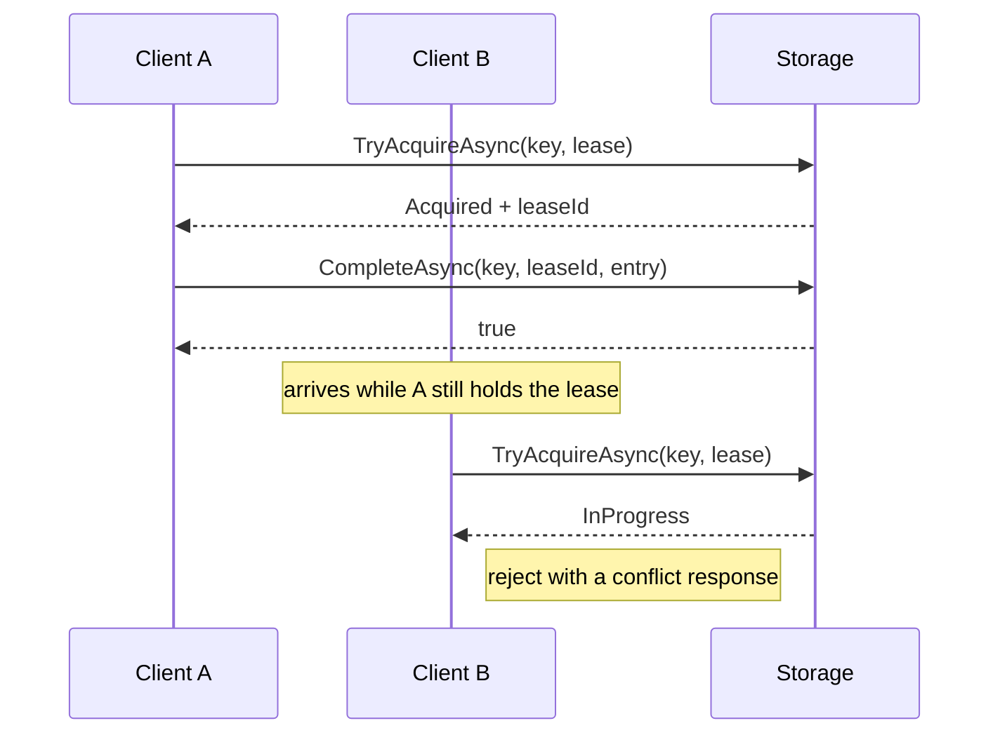

# 💾 Storage Providers

`CoreSystem.Idempotency` ships with two storage providers — [Redis](Providers/Redis.md) and
[PostgreSQL](Providers/PostgreSQL.md). This page describes the contract they implement, for
anyone writing a provider for another store.

The core package is storage-agnostic and never references a provider. Persistence is reached
only through the public `IIdempotencyStorage` interface, so adding a new technology means
shipping a new package that implements it — the core package does not change.

---

## 🔑 The Storage Contract

```csharp
namespace Core.Idempotency.Abstractions;

public interface IIdempotencyStorage
{
    Task<IdempotencyAcquireResult> TryAcquireAsync(
        string key,
        TimeSpan leaseDuration,
        CancellationToken ct = default);

    Task<bool> CompleteAsync(
        string key,
        string leaseId,
        IdempotencyEntry entry,
        TimeSpan? expiration = null,
        CancellationToken ct = default);

    Task ReleaseAsync(
        string key,
        string leaseId,
        CancellationToken ct = default);

    Task<IdempotencyEntry?> GetAsync(
        string key,
        CancellationToken ct = default);

    Task SetAsync(
        string key,
        IdempotencyEntry entry,
        TimeSpan? expiration = null,
        CancellationToken ct = default);
}
```

---

## 🔄 The Lifecycle Is Lease Based



A request first claims a key with `TryAcquireAsync`, then either stores its response with
`CompleteAsync` or hands the key back with `ReleaseAsync`. **Only the holder of a lease may
complete or release the entry.**

`TryAcquireAsync` must be atomic. Two concurrent requests presenting the same key must never
both succeed — one acquires the lease and the other observes `InProgress`.

### 🔄 The Five Methods

| Method | Contract |
|---|---|
| `TryAcquireAsync` | Attempts to claim ownership of a key. Returns `Acquired` when the caller now owns the lease, otherwise the current state of the entry |
| `CompleteAsync` | Stores the response for a key previously claimed. Returns `false` when the lease was lost or had already expired, in which case nothing was stored |
| `ReleaseAsync` | Releases a claimed key without storing a response, so the next request can retry it |
| `GetAsync` | Retrieves a completed entry for replay, or `null` when no completed, unexpired entry exists |
| `SetAsync` | Stores an entry without acquiring a lease first |

`leaseDuration` bounds how long a crashed in-flight request can block others: once the lease
expires another request may claim the key. When `expiration` is `null`, the provider applies
its own default.

---

## 📦 The Models

### 🏷️ IdempotencyAcquireStatus

| Value | Meaning |
|---|---|
| `Acquired` | The caller acquired the lease and is responsible for executing the request and then completing or releasing the key |
| `InProgress` | Another request currently owns the lease. The caller must not execute the endpoint and should reject the request with a conflict response |
| `Completed` | A completed entry already exists. The caller should replay `Entry` without executing the endpoint |

### 🏷️ IdempotencyAcquireResult

| Member | Type | Notes |
|---|---|---|
| `Status` | `IdempotencyAcquireStatus` | Required |
| `LeaseId` | `string?` | Present when `Status` is `Acquired`; pass it back to `CompleteAsync` or `ReleaseAsync` |
| `Entry` | `IdempotencyEntry?` | Populated when `Status` is `Completed` |

### 💾 IdempotencyEntry

| Member | Type | Notes |
|---|---|---|
| `RequestFingerprint` | `RequestFingerprint?` | Compared against the incoming request on replay |
| `Response` | `IdempotencyResponse` | Required |

### 💾 IdempotencyResponse

| Member | Type | Notes |
|---|---|---|
| `StatusCode` | `int` | Required |
| `ContentType` | `string?` | |
| `Body` | `byte[]` | Required |
| `Headers` | `IReadOnlyDictionary<string, string[]>` | Required; replayed to the client |

### 🔍 RequestFingerprint

A `record` with two required members: `HashAlgorithm` and `Value`. Persist both so a
reimplementation of the algorithm cannot silently invalidate existing entries.

---

## 🧩 Registering a Provider

A provider registers its implementation as a singleton, exactly as the shipped providers do:

```csharp
services.AddSingleton<IIdempotencyStorage, YourIdempotencyStorage>();
```

Reference `src/Core.Idempotency.Redis` for a complete provider layout:
`DependencyInjection/`, `Options/` and `Storage/`, plus `Builders/` where the store needs
composed keys.

---

> **Note**
>
> The lifecycle is part of the public contract. Changing the semantics of any method on
> `IIdempotencyStorage` is a breaking change for every provider and must be reflected in all
> providers, tests, documentation and the changelog.